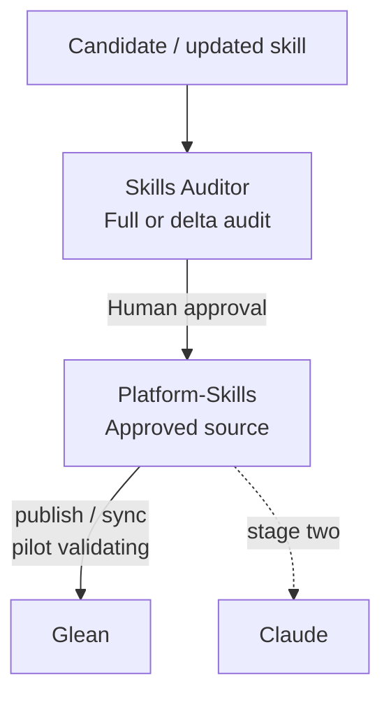
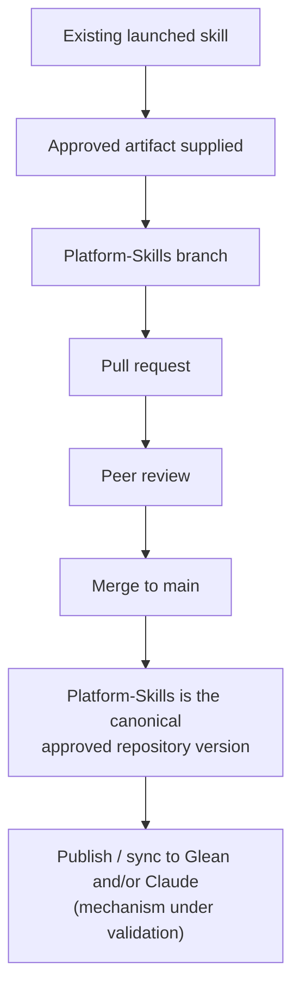
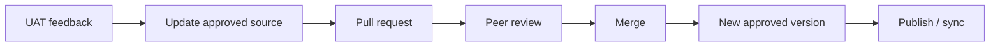

# Platform-Skills

**Skills Auditor is where we audit. Platform-Skills is where the approved version lives.**

Platform-Skills is the proposed maintained source for Skills that earn AHEAD Platform Skill status, with their version history. The current pilot is **Glean-first**; Claude distribution is stage two.

Status labels used below: **CONFIRMED** (demonstrated), **TESTING** (in progress), **OPEN** (unresolved or unproven), **BLOCKED** (cannot proceed until something else is resolved).

## What this is, and what it is not

Platform-Skills **is**:

- the proposed single home of each approved Platform Skill, so a Skill is maintained once rather than edited separately on each platform
- the version history of those Skills: every change is a pull request with a reviewer
- the pilot workspace for validating how Glean (and later Claude) consume Skills from this repository

Platform-Skills **is not**:

- the audit workflow. That is [Skills Auditor](#relationship-to-skills-auditor), a separate repository (formerly Skills Marketplace).
- a broad, company-wide intake channel
- a proven automated publishing path. GitHub-to-Glean sync is still being validated (see [Validation matrix](#validation-matrix)).
- a place for credentials, runtime infrastructure, or operational state

## Operating model

| Role | Owns |
| --- | --- |
| Domain teams / aligned FDEs | Skill business logic and ongoing maintenance |
| Enterprise GPT | Standards, qualification and auditing, promotion rules, shared distribution architecture |

- **New Skill: full audit.**
- **Update to an existing Platform Skill: delta/regression audit.**
- **Human approval is required before promotion.** Automated checks support the reviewer; they do not replace them.

## Relationship to Skills Auditor

| Repository | Role |
| --- | --- |
| Skills Auditor | Audit of a new or updated Skill before it is promoted |
| Platform-Skills (this repo) | Maintained source for approved Platform Skills and their version history |



## Package philosophy

- Users work with portable Skill **packages**, not repository internals. They should not need to hand-edit files in this repo.
- Glean exports Skills as **ZIP packages**.
- The six seed ZIP exports are **untouched baseline exports**, staged on the pilot pull request (not yet on `main`; see the [PTO handoff](docs/PTO-HANDOFF-2026-10-19.md)). They must remain byte-for-byte unchanged.
- **Implemented:** the ZIP stays canonical, and `tools/skillpkg.py` deterministically generates the Glean-readable folder (`projections/glean/<id>/`) plus provenance once a Skill is audited and approved. Glean's acceptance of that folder from `main` is still to be confirmed.

## Pipeline and operations

| Doc | Contents |
| --- | --- |
| [docs/OPERATIONS.md](docs/OPERATIONS.md) | Submit, update, audit, approve, project, Glean release, rollback, troubleshooting |
| [docs/GOVERNANCE.md](docs/GOVERNANCE.md) | Approval authority, trust boundaries, required branch protection |
| [docs/AUDITOR-CONTRACT.md](docs/AUDITOR-CONTRACT.md) | Skills Auditor interface and integration status (**not yet integrated**) |
| [docs/PRIORITY-1.md](docs/PRIORITY-1.md) | **Start here (admins):** ratify the merged tooling and protect `main` |
| [docs/PTO-HANDOFF-2026-10-19.md](docs/PTO-HANDOFF-2026-10-19.md) | Current state, open PRs, next actions |

CI (`validate-skills`) runs unit tests and a policy gate on every PR, with a read-only token and no secrets. Any new or changed Skill ZIP is **blocked** until a trusted Skills Auditor result exists. That block is intentional.

## Glean pilot status

| Finding | Status |
| --- | --- |
| Direct GitHub Skill import was previously demonstrated | CONFIRMED |
| Nested Skill reference files were discovered successfully | CONFIRMED |
| Private-repository import failure. Strongly suggests an authorization issue; root cause not proven | OPEN |
| Scheduled GitHub sync. Prior result is inconclusive, not a failure of the architecture | OPEN |
| ZIP-from-GitHub synchronization support. Not tested or vendor-confirmed | OPEN |

### Why the previous sync experiment is inconclusive

- It used a throwaway Skill.
- It ran on an experiment branch, not the intended canonical `main` path.
- Repository visibility changed during the experiment.
- The Glean-side Skill was also interacted with and modified.

A clean GitHub-only-writer test is still required.

## Validation matrix

| Area | Status | Notes |
| --- | --- | --- |
| Existing Shared Skill vs newly uploaded package: coexistence / deduplication | TESTING | Using the six baseline exports |
| Canonical Git representation: ZIP vs expanded Skill directory | OPEN | Align with Grace, confirm with Glean |
| GitHub update propagation | OPEN | |
| Refresh / scheduled-sync behavior | OPEN | Needs the clean test below |
| Private-repository authorization | OPEN | Hypothesis only; not proven |
| Organization-wide publication / migration behavior | OPEN | |

## Next execution sequence

1. Capture the six existing org-wide Skill exports. *(Staged in `skills/shared/`.)*
2. Test how Glean handles imported/uploaded copies alongside existing Shared Skills.
3. Align package representation with Grace.
4. Merge the approved pilot representation to `main`.
5. Select one real Skill for a clean GitHub-backed synchronization test. **GitHub is the sole writer** during that test: no edits in Glean.
6. Take unresolved product/platform questions to Glean.

## What belongs here

- Approved Skill packages, under [`skills/`](skills/README.md)
- Short pointers to the Skill standard, under [`standards/`](standards/README.md)
- Contribution and review guidance ([CONTRIBUTING.md](CONTRIBUTING.md))

## What does not belong here

- Credentials, API keys, tokens, or other secrets
- Unapproved or experimental candidate Skills (they go through Skills Auditor first)
- Skills Auditor evaluation logic, AI judging, or audit state
- Deployment, sync, or notification infrastructure
- Client data or other confidential material

## How a skill moves

1. **Candidate**: a new or updated Skill is drafted by the owning domain team / FDE.
2. **Audited**: Skills Auditor runs a full audit (new Skill) or a delta/regression audit (update).
3. **Approved**: a human approves, and it is merged into this repository. The merged state is the approved version.
4. **Maintained**: later changes, including UAT feedback, come in as pull requests here.
5. **Published**: the approved version reaches Glean and/or Claude. Publishing is separate from merging, and the mechanism (manual vs GitHub sync) is under validation.

## Initial Landing Set

The first population of this repository is the set of Skills launched through the initial Enterprise GPT Skills rollout on September 28, 2026:

- `story-writing-for-presentations`
- `outlook-event-creation`
- `ahead-meeting-prep-and-notes`
- `ahead-weekly-recap`
- `ahead-skill-package-builder`
- `ahead-daily-digest`

These were launched in Glean and were also announced as available to users with Claude access.

The six Glean org-wide export ZIPs are now staged under `skills/shared/` as baseline artifacts. Staging them does **not** mean they are approved Platform Skills or that anything has been published.

- Each landed Skill should preserve its version history and provenance.
- Once an artifact is reviewed and merged, `main` is the approved source for that Skill.
- Availability in Glean or Claude is separate from the repository source of truth.
- Updates based on UAT or user feedback come back through a new branch and pull request, not through silent changes to deployed copies.

### Landing workflow



## Version history

Git is the version history. Each approved change is a merged pull request, so the diff, the reviewer, and the reasoning stay attached to the change. To see what changed in a Skill, read its history:

```sh
git log --follow -- skills/<platform>/<skill-name>
```

## Why human review is the approval gate

A Skill shapes what Claude and Glean do for AHEAD employees. Automated checks catch structure and consistency problems, but a teammate has to confirm the Skill is correct and appropriate. Merging a pull request in this repository is that confirmation, which is why the author never approves their own change.

## How UAT feedback becomes a change

UAT feedback is never applied as an undocumented edit directly on a platform. It follows the same path as any other change:



If a platform copy has been edited directly, bring that change back here as a pull request so the repository stays the source of truth.

## Repository layout

```text
README.md            this file
CONTRIBUTING.md      how to propose and review a change
skills/              Skills (claude/, glean/, shared/ for source ZIPs)
projections/glean/   generated Glean-readable folders (approved Skills only)
provenance/          per-Skill hash, audit and deployment record
tools/skillpkg.py    validation, projection and CI gate (stdlib Python)
tests/               unit tests (python3 -I -m unittest discover -s tests)
docs/                operations, governance, Auditor contract, handoff
standards/           pointers to the Skill standard
.github/             CODEOWNERS, pull request template, validate-skills workflow
```

See [CONTRIBUTING.md](CONTRIBUTING.md) to propose a change.
